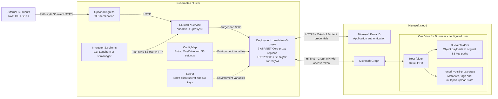

# OneDrive S3 Proxy

An ASP.NET Core proxy that exposes a focused S3-compatible API and stores objects in
OneDrive for Business through Microsoft Graph.

Each S3 bucket is a folder below the configured OneDrive root folder. Object payloads
use their original S3 key paths directly under the bucket, subject to OneDrive's
file-name, path-length, and case-insensitive naming restrictions. The service uses an Entra application
and the OAuth 2.0 client-credentials flow. `Azure.Identity` caches and refreshes the
Graph access token for the process lifetime.

## Infrastructure

The diagram shows the Kubernetes deployment with its default ports and replica
count. Add a TLS-terminating ingress separately for external access; in-cluster
clients can use the ClusterIP Service directly.



S3 clients use the proxy's access and secret keys, not Entra credentials. The proxy
obtains its own Graph token using the Entra application credentials. Persistent
object data and upload state live in OneDrive; the deployment requires no
PersistentVolumeClaim or separate database.

For a local Docker deployment, clients connect to the published proxy port instead
of the Kubernetes Service; the Microsoft cloud dependencies remain the same.

## Supported API

- AWS Signature Versions 2 and 4 header and presigned URL authentication
- List, create, head, and delete buckets
- ListObjects (v1 `marker`) and ListObjectsV2 with `prefix`, `delimiter`, `max-keys`,
  `start-after`, and continuation tokens
- Put, get, head, and delete objects
- Multipart uploads backed by persistent OneDrive parts and Graph upload sessions
- Single byte-range downloads
- CopyObject within the configured OneDrive, including asynchronous Graph job monitoring
- Object content headers, user metadata, and up to 10 object tags

ACLs, bucket policies, versioning, server-side encryption, lifecycle rules, UploadPartCopy,
and virtual-hosted bucket URLs are not supported. Requests for any unsupported
sub-resource (for example `?acl`, `?versionId`, `?policy`, or `?versioning`) are rejected
with `501 NotImplemented` instead of running as a plain bucket or object operation.
Versioned `x-amz-copy-source` values are also rejected with `501 NotImplemented`.
Uploads require `Content-Length`; tags are validated before storing the payload.
Multi-object delete requests reject missing or invalid keys before deleting any objects.
The default 238,000 MiB limit stays below OneDrive's 250 GB file limit and can be
reduced with configuration.

Single-object uploads return a quoted, lowercase content-MD5 ETag, including when
Graph upload sessions are used. Multipart ETags use the MD5 of the concatenated
binary part MD5s followed by `-<part-count>`. ETags are persisted with object
metadata and reused by GET, HEAD, listings, and copies; metadata/tag updates do not
change them. Listings read the small metadata sidecars with bounded concurrency,
not the object payloads.

Objects uploaded before this fix, files added directly in OneDrive, and payloads
edited outside the proxy retain OneDrive's opaque version tags until re-uploaded
through the proxy. The proxy does not download or rewrite existing backups to
backfill checksums. A stored checksum is used only while its OneDrive version tag
still matches the payload.

SigV4 requests must sign the `host` header and every `x-amz-*` header they send (other than
`x-amz-date` and `x-amz-content-sha256`, which are bound by the signature itself).
SigV4 header-signed requests must be within 15 minutes of the server clock; presigned URLs
are accepted from 15 minutes before their signing time until they expire. The
`/health/live` and `/health/ready` GET probes are the only unauthenticated paths.
The proxy refuses to start when the Entra, OneDrive, or S3 settings (including the
access and secret keys) are missing.

### Legacy SigV2 clients

SigV2 is detected automatically and uses the same `S3__AccessKey` and `S3__SecretKey`
as SigV4; no additional configuration is needed. It supports:

- `Authorization: AWS <access-key>:<base64-hmac-sha1-signature>` with a `Date` or
  `x-amz-date` header within 15 minutes of the server clock.
- Presigned URLs with `AWSAccessKeyId`, `Signature`, and `Expires` (a Unix timestamp
  in seconds). The signature must be URL-encoded and the URL is rejected after expiry.
- Canonicalized `x-amz-*` headers and S3 subresources, including multipart uploads
  and tagging. A supplied `Content-MD5` is signed and validated while reading the body.

Both versions require path-style bucket addressing. Do not mix header and query
authentication or SigV2 and SigV4 credentials in the same request. Prefer SigV4 for
new clients. SigV2 uses legacy HMAC-SHA1 and does not sign most listing query
parameters or protect the body when `Content-MD5` is absent; use HTTPS.

## Entra setup

1. Register a single-tenant application in Microsoft Entra ID.
2. Add the Microsoft Graph **application** permission `Files.ReadWrite.All`.
3. Grant tenant-wide admin consent.
4. Create a client secret and record its value.
5. Set `OneDrive__UserId` to the target user's object ID or UPN. The user must have a
   provisioned OneDrive for Business drive.

The permission can access every user's files in the tenant. Protect the client secret,
use a dedicated application, and apply Conditional Access/workload restrictions where
available.

## Configuration

ASP.NET Core maps double underscores in environment variables to configuration sections:

| Variable | Description |
| --- | --- |
| `Entra__TenantId` | Entra tenant ID |
| `Entra__ClientId` | Application/client ID |
| `Entra__ClientSecret` | Application secret |
| `OneDrive__UserId` | Target OneDrive user object ID or UPN |
| `OneDrive__RootFolder` | Container folder in OneDrive; default `S3` |
| `OneDrive__MaxConcurrency` | Concurrent outbound Graph/upload/monitor requests per proxy instance (through response headers), from 1 through 32; default `4` |
| `OneDrive__MaxRetries` | Retries per Graph request after HTTP 429, from 0 through 10; default `5` |
| `S3__URL` | Listener URL including port; default `http://+:9000`. Overrides ASP.NET Core URL/port environment settings. Kubernetes ports are generated from this value. |
| `S3__AccessKey` | Access key clients use |
| `S3__SecretKey` | Long random signing secret |
| `S3__Region` | SigV4 region; default `us-east-1` |
| `S3__MaxUploadSizeMiB` | Upload limit from 1 through 238000; default `238000` |

## OneDrive storage layout

Object payloads are stored directly under their bucket using the original S3 key.
For example, `backupstore/volumes/backup.blk` in bucket `longhorn` is stored at
`S3/longhorn/backupstore/volumes/backup.blk` when `OneDrive__RootFolder` is `S3`.
The proxy creates subfolders as needed; new objects do not use a DataFolder.

Deleting the last object in a folder removes that empty folder and any empty
ancestors, stopping before the bucket. This applies to single-object deletes,
multi-object deletes, and `aws s3 rm --recursive`. Object metadata is deleted too;
empty metadata hash-shard and per-bucket directories below
`.onedrive-s3-proxy-state/objects` are pruned. The bucket, OneDrive root, state root,
and active multipart upload state are preserved. Cleanup stops at any remaining
child, including an empty subfolder; it does not sweep unrelated or previously
empty directories.

**Avoid concurrent writes during deletion cleanup.** Stop uploads, copies, and
multipart completions into the affected payload folders, and metadata writes into
the affected state directories, across all proxy instances and OneDrive clients.
Folder cleanup checks children and uses conditional deletes, but Graph folder
ETags do not reliably track child additions: a concurrent new child could be
deleted with its parent. There is no distributed writer lock. Conflicting or
entity-tag-mismatched folders are left in place; other Graph errors are returned
to the caller.

OneDrive file names and paths constrain the accepted S3 keys. New writes reject
empty path segments, leading/trailing slashes, leading/trailing spaces, trailing
dots, reserved names, unsupported characters, and paths exceeding 400 characters
(including the configured root and bucket). Keys that differ only in case, and
file/folder conflicts such as `a` and `a/b`, cannot coexist and are rejected rather
than overwriting another object.

Content headers, user metadata, and tags remain in the root's
`.onedrive-s3-proxy-state` folder. Unfinished multipart bodies use immutable names
there; multipart completion writes the object at its original key path.
Do not edit or delete the internal state folder. Editing payloads directly in
OneDrive does not update the associated S3 metadata.

Starting with version 0.1.3, the old hashed payload layout is not supported.
Existing files below `.onedrive-s3-proxy-objects` are treated as ordinary files at
their literal paths, not resolved to their original S3 keys. Migrate or recreate
old objects at their original key paths before upgrading. The proxy does not
automatically migrate, hide, or delete old payloads. Metadata identifiers in the
separate state folder remain hashed; object payloads do not.

## Build and run

The application and tests target .NET 10. Install the .NET 10 SDK for local builds.
CI and the Docker build use the .NET 10 SDK, and the container uses the ASP.NET
Core 10 runtime. Keep their major versions aligned with the target framework.

```powershell
dotnet test .\OneDriveS3Proxy.sln --configuration Release
docker build -t onedrive-s3-proxy:local .
```

Run the image with the variables above and publish the port specified by `S3__URL`.
For example, use `-e S3__URL=http://+:9000 -p 9000:9000` with `docker run`.
There is no fixed Docker `EXPOSE` port. Configure an S3 client for path-style addressing:

```powershell
aws --endpoint-url http://localhost:9000 s3api list-buckets
aws --endpoint-url http://localhost:9000 s3 cp .\example.txt s3://example-bucket/example.txt
```

Set `AWS_ACCESS_KEY_ID`, `AWS_SECRET_ACCESS_KEY`, and `AWS_DEFAULT_REGION` to the same
S3 values configured on the proxy. Use TLS at the ingress or load balancer in production.

## CI, dependency updates, and container images

[GitHub Actions](.github/workflows/ci.yml) restores dependencies and runs the Release
test suite on pushes to `main` and on pull requests, including when a PR is merged.
Closing a PR without merging skips the jobs. Changes that only touch files under
`.github/` (workflows, Dependabot configuration) do not trigger it; a change that also
touches any other file does. The Docker image is built only after tests pass. Pull
request updates (including Dependabot and fork PRs), direct pushes, and manual
runs on branches other than `main` build without logging in or publishing. If you require the `Test` and `Build and publish
image` checks in branch protection, a PR that only changes `.github/` files will wait
on checks that never run, so temporarily adjust the rule or merge it as an admin.

Manual execution is enabled for any branch through `workflow_dispatch`. In GitHub,
open **Actions > CI > Run workflow**, select the desired branch in **Use workflow
from**, and click **Run workflow**. The workflow must exist on the default branch
for GitHub to offer manual execution, and the selected branch must also contain
the workflow with `workflow_dispatch` enabled. Alternatively, use the GitHub CLI:

```powershell
gh workflow run ci.yml --ref <branch-name>
```

Manual runs on `main` run the tests, build, and publish the image using the current
changelog version. For example, `gh workflow run ci.yml --ref main` publishes
`0.1.3` when that is the latest release heading. Manual runs on other branches
run the tests and Docker build without publishing an image.

Images are published when a pull request is **merged into `main`** or CI is
**run manually on `main`**. PR merges use the merge commit for checkout, image
revision, and SHA tag; manual runs use the selected `main` commit. Direct pushes
to `main`, open PR updates, and unmerged PR closures never publish.
Publishing uses the workflow's `GITHUB_TOKEN` for GitHub Container Registry (GHCR);
no registry password secret is required. The image
name is `ghcr.io/<owner>/<repository>`, converted to lowercase, with these tags:

- `0.1.3`: the first released version heading in [CHANGELOG.md](CHANGELOG.md).
- `latest`: the most recent successful merged-PR or manual `main` publish.
- `sha-<full-commit-sha>`: a commit-specific tag for traceability.
- `run-<run-id>-<attempt>`: a unique tag that retains the published index when a
  version or commit is published again.

Merge publishing uses `pull_request_target` only for closed PRs targeting `main`,
and its jobs require the PR to be merged before checking out the merge commit.
This permits publishing merged fork PRs without granting open PR builds registry
write access. Open PR updates continue to use the unprivileged `pull_request` event.

These tags reference a multi-architecture manifest covering `linux/amd64` and `linux/arm64`, so
the same tag works on x64 and ARM64 (for example Raspberry Pi or Graviton/Ampere) nodes.
Successful publishes also tag each platform image directly with
`<version>-amd64` / `<version>-arm64`, `sha-<commit>-amd64` / `sha-<commit>-arm64`,
and `run-<run-id>-<attempt>-amd64` / `run-<run-id>-<attempt>-arm64`. The run tags
prevent older platform images from becoming untagged when a version or commit is
republished. Platform tagging uses the published index's digest rather than moving
tags, and does not create additional indexes.

Buildx provenance and SBOM attestations are disabled. Each successful publish
therefore produces three tagged GHCR versions: one multi-architecture index and
two platform images, not extra untagged attestation manifests. Platform images
may briefly appear untagged while the final tagging step is running; a failed or
cancelled publish can leave tagging incomplete. Existing untagged versions from
older publishes are not removed. Do not delete untagged platform images still
referenced by an index you intend to keep.
The .NET build stage in the [Dockerfile](Dockerfile) always runs on the CI runner's
native platform (`--platform=$BUILDPLATFORM`) and produces architecture-independent
output, so no QEMU emulation is needed. Keep it that way: a `RUN` instruction in the
final stage would run under emulation for the non-native platform and require
`docker/setup-qemu-action` in the workflow.
Keep changelog releases newest first, using `## [MAJOR.MINOR.PATCH] - YYYY-MM-DD`.
An optional `## [Unreleased]` section is skipped. Missing or invalid release versions
fail the image job rather than silently publishing an incorrect version.
To change the version tag, add a new release heading and its release notes before
merging to `main`. For example, `## [0.2.0] - 2026-11-01` produces
`ghcr.io/<owner>/<repository>:0.2.0`.

Version and `latest` tags move on each merged-PR or manual `main` publish, even if the changelog
version has not changed. Use an image digest for immutable deployments; the SHA tag
identifies the source commit but can also be overwritten by a workflow rerun.
This workflow does not create Git tags or GitHub Releases. If release-only images
are needed later, publish on `v*` Git tags and verify that the tag matches the
changelog version before pushing.

Ensure GitHub Actions is enabled and repository or organization policies allow the
workflow to write packages. GHCR packages may initially be private; adjust the
package visibility for public pulls, or configure a Kubernetes image-pull secret
for private images.

Package versions are not deleted automatically. Older merged-PR builds and
multi-architecture components remain in GHCR unless removed manually.

[Dependabot](.github/dependabot.yml) checks NuGet packages in the solution, Docker
base images, and GitHub Actions weekly. NuGet, Docker, and action updates are grouped by
ecosystem; dependency PRs run through the same CI checks. Configure branch
protection to require the `Test` and `Build and publish image` checks before merging.

## Kubernetes

1. Build and push the image, then set the image in `k8s/deployment.template.yaml` to the version
   tag CI publishes (for example `ghcr.io/<owner>/onedrive-s3-proxy:0.1.0`). Avoid
   `latest`: with `IfNotPresent` nodes would never pull updates. Change the tag to
   roll out a new version.
2. Replace the IDs and user in `k8s/configmap.yaml`. Set `S3__URL` to a single HTTP
   listener URL with an explicit port, such as `"http://+:9000"`. Keep the value
   double-quoted. The renderer derives the container port, both probe ports, and
   Service target port from this URL; the Service's public port remains 80.
3. Create the secret without checking credentials into source control:

   ```powershell
   kubectl create secret generic onedrive-s3-proxy `
     --from-literal=Entra__ClientSecret='<entra-secret>' `
     --from-literal=S3__AccessKey='<access-key>' `
     --from-literal=S3__SecretKey='<long-random-secret>'
   ```

4. Generate the manifests with PowerShell and deploy:

   ```powershell
   .\k8s\render.ps1 | kubectl apply -f -
   ```

Add an Ingress appropriate for your cluster and terminate TLS there. Do not apply
`secret.example.yaml`; it is only a key-name reference.
Do not apply `deployment.template.yaml` directly. Rerun the renderer whenever
`S3__URL` changes, then restart the pods with
`kubectl rollout restart deployment/onedrive-s3-proxy` so they reload the ConfigMap.

The liveness endpoint only verifies that the process is running. The readiness endpoint
validates access to the configured Graph drive and root folder with a five-second
deadline, then caches success for 30 seconds to limit probe traffic.

## Longhorn backup target

### Microsoft Graph throttling

Longhorn block uploads can exceed OneDrive's request limits. The proxy retries
HTTP 429 responses, honoring the `Retry-After` header (seconds or HTTP date), then
`error.retryAfterSeconds` in the JSON response, or exponential backoff with jitter
when neither is available. A shared cooldown pauses new outbound requests across
uploads, metadata operations, and copy monitoring within each proxy instance.
Upload request bodies are buffered up to 10 MiB for replay; complete large objects
are not buffered in memory. Each throttled retry and exhausted retry budget is logged.

The default concurrency limit is four requests per instance, with up to five retries
per request. Set `OneDrive__MaxConcurrency` to `1` or `2` and reduce Longhorn backup
concurrency if throttling persists. Multiple proxy replicas each have their own
limit and cooldown; these controls do not coordinate across pods or remove
Microsoft's service limits. Waiting respects request cancellation and HTTP client
timeouts. After retries are exhausted, the proxy still returns S3 `503 SlowDown`,
so a sustained service limit can still fail a backup. Apply configuration changes
and restart the pods before retrying the backup.

### Backup configuration

The proxy is compatible with the S3 operations used by Longhorn volume backups:
`ListObjectsV2`, `HeadObject`, single-part `PutObject`, `GetObject`, and
`DeleteObject`. Compatibility tests exercise the same path-style request sequence,
prefix/delimiter listing, SigV4 authentication, and response fields used by the
Longhorn backupstore driver.

Before configuring Longhorn, create the bucket because Longhorn does not create it. You
can use the AWS CLI or create the bucket folder directly in OneDrive.

```powershell
kubectl port-forward service/onedrive-s3-proxy 9000:80
```

In another terminal:

```powershell
aws --endpoint-url http://localhost:9000 s3api create-bucket --bucket longhorn
```

Create a credential secret in `longhorn-system` using
`k8s/longhorn-backup-target-secret.example.yaml` as a reference. Its access and secret
keys must match the proxy configuration. Change the service DNS name if the proxy is
deployed outside the `default` namespace.

Configure the Longhorn backup target with:

```text
s3://longhorn@us-east-1/
```

Use `onedrive-s3-backup-target` as the credential secret. The trailing slash, region,
`AWS_ENDPOINTS`, and `VIRTUAL_HOSTED_STYLE=false` are required for this path-style
endpoint.

Standard Longhorn volume backups and its multipart-capable single-file upload path are
supported within the configured object-size limit. Object listing resolves the folder
portion of the requested prefix directly and traverses only matching branches, so listing
system backups does not scan unrelated volume-block directories. Delimiter listings
stop searching a grouped subtree after finding one file; empty folders are not exposed
as S3 common prefixes. Listings still require live Graph requests, and broad listings or
sustained Microsoft Graph throttling can still exceed a client's timeout.

References:

- [Longhorn backup target configuration](https://longhorn.io/docs/1.13.0/snapshots-and-backups/backup-and-restore/set-backup-target/)
- [Longhorn S3 backupstore driver](https://github.com/longhorn/backupstore/blob/master/s3/s3_service.go)

## Test with s3manager

The test deployment in `k8s/s3manager-test.yaml` reads the proxy's existing access
keys, uses SigV4 and path-style bucket addressing, and is exposed only as a ClusterIP
service.

Deploy and open it locally:

```powershell
kubectl apply -f .\k8s\s3manager-test.yaml
kubectl rollout status deployment/s3manager
kubectl port-forward service/s3manager 8081:8080
```

Open `http://localhost:8081`. Test creating a bucket, uploading a small file, browsing
and downloading it, deleting objects, and deleting the empty bucket.

The validated s3manager operations are bucket listing/location/create/delete,
ListObjectsV2, single-part and multipart upload, range and full download/head,
presigned download, copy, metadata/tags, and multi-object delete. Bucket policies,
object versions, ACLs/public access, and server-side encryption remain unsupported.
The manifest disables the version UI feature.

s3manager has no built-in user authentication and anyone who can reach it can use the
configured S3 credentials. Keep the service internal, use `kubectl port-forward` for
testing, and delete the deployment afterward:

```powershell
kubectl delete -f .\k8s\s3manager-test.yaml
```

Reference: [cloudlena/s3manager](https://github.com/cloudlena/s3manager)

## License

This project is licensed under the [MIT License](LICENSE).
